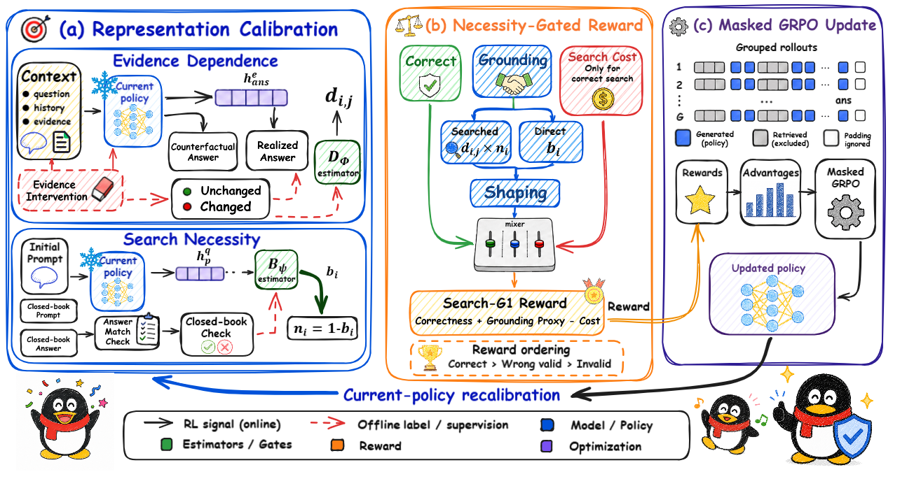
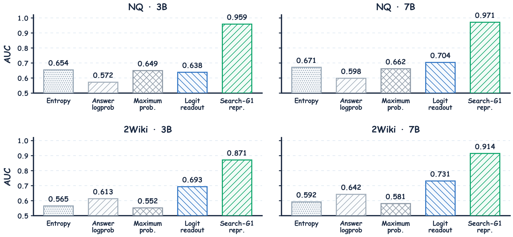

# Search-G1: Representation-Level Intrinsic Rewards for Grounded Search Agents

<p align="center">
  
</p>

Search-G1 trains search agents with intrinsic rewards read directly from policy
representations. It combines two lightweight, periodically refreshed readouts:

- **Evidence Dependence** estimates whether a completed answer depends on retrieved evidence.
- **Search Necessity** estimates whether the current policy is unlikely to answer the question correctly without retrieval.

The resulting **Necessity Gate** rewards grounding when search is useful, while a bounded
**Search Cost** discourages repeated retrieval. Training uses masked GRPO so that gradients
are applied only to policy-generated reasoning, search actions, and answers; retrieved text
is context, not an optimization target. As policy representations change, Search-G1
recalibrates both readouts from fresh trajectories, forming reward--policy co-evolution.

## Method

For a rollout, the answer-commit readout returns Evidence Dependence `d` and the prompt-state
readout returns closed-book sufficiency `b`. Search Necessity is `1 - b`, giving the grounding
score

```text
grounding = d * (1 - b)
search_cost = min(1, max(number_of_searches - 1, 0))
```

Correct searched answers receive an additive grounding bonus and repeated-search cost.
Correct direct answers receive a closed-book-sufficiency bonus. Wrong and invalid outputs
remain below correct outputs, preserving task-outcome ordering while creating useful
within-group credit when EM is otherwise constant.

The paper configuration uses the hidden state at the final generated answer token for
Evidence Dependence and the hidden state at the end of the initial agent prompt for Search
Necessity. Evidence Dependence labels are obtained by deleting retrieved evidence, retaining
the rollout's reasoning and search history, and deterministically re-decoding the answer.

## Paper-Reported Results

The following headline values are transcribed from the manuscript. Task columns report EM;
TC and D-Inv are operational grounding metrics; Search/Q is the number of policy-emitted
search actions per question. The manuscript reports means over four repetitions.

### Qwen2.5-3B-Instruct

| Method | NQ EM ↑ | HotpotQA EM ↑ | 2Wiki EM ↑ | MuSiQue EM ↑ | TC ↑ | D-Inv ↓ | Search/Q ↓ |
|---|---:|---:|---:|---:|---:|---:|---:|
| Base | 0.142 | 0.153 | 0.212 | 0.029 | - | - | 0.000 |
| Prompted Search | 0.250 | 0.199 | 0.238 | 0.057 | 0.930 | 0.069 | 2.215 |
| Search-R1 | 0.352 | 0.248 | 0.267 | 0.087 | 0.917 | 0.049 | 3.281 |
| **Search-G1** | **0.453** | **0.306** | **0.368** | **0.143** | **0.976** | **0.034** | **2.094** |

### Qwen2.5-7B-Instruct

| Method | NQ EM ↑ | HotpotQA EM ↑ | 2Wiki EM ↑ | MuSiQue EM ↑ | TC ↑ | D-Inv ↓ | Search/Q ↓ |
|---|---:|---:|---:|---:|---:|---:|---:|
| Base | 0.192 | 0.183 | 0.250 | 0.031 | - | - | 0.000 |
| Prompted Search | 0.349 | 0.299 | 0.235 | 0.058 | 0.936 | 0.061 | 2.171 |
| Search-R1 | 0.393 | 0.370 | 0.414 | 0.146 | 0.932 | 0.046 | 3.090 |
| **Search-G1** | **0.512** | **0.450** | **0.475** | **0.254** | **0.981** | **0.028** | **1.860** |

<p align="center">
  
</p>

The Evidence Dependence readout reaches AUC 0.959/0.971 on NQ and 0.871/0.914 on
2WikiMultiHopQA for the 3B/7B backbones, respectively.

## Repository Map

| Component | Main files |
|---|---|
| Calibration rollouts and counterfactual labels | `ts_probe_dump.py` |
| Readout fitting and grouped validation | `ts_probe_train.py` |
| Hot-reloaded representation evaluator | `probe_server.py` |
| Necessity-Gated Reward and Search Cost | `verl/trainer/main_ppo_eco.py` |
| Masked multi-turn rollout generation | `search_r1/llm_agent/generation.py` |
| Masked GRPO optimization | `verl/trainer/ppo/`, `verl/workers/actor/` |
| Reward--policy co-evolution | `ts_coevolve.py` |
| Counterfactual grounding evaluation | `cf_judge_server.py` |
| Dense retrieval service | `search_r1/search/retrieval_server.py` |
| Analysis and plotting | `analysis/` |

## Installation

The reference environment uses Python 3.10, PyTorch with CUDA, Transformers `<4.48`, and
vLLM `<=0.6.3`. Create a CUDA environment appropriate for your hardware, then install:

```bash
git clone https://github.com/Rosy0912/Search-G1.git
cd Search-G1
pip install -e .
```

`requirements.txt` includes CPU FAISS for portability. Replace it with the matching GPU
FAISS package when running a GPU-resident index. FlashAttention is optional if your hardware
uses the xFormers/SDPA path.

## Data and Retrieval

The QA data follow the Search-R1 parquet schema. Prepare each FlashRAG benchmark split with:

```bash
python scripts/prepare_qa.py --dataset nq --split train \
  --output data/nq_search/train.parquet \
  --calibration-output data/nq_search/calibration.parquet \
  --calibration-size 300 --calibration-offset 3000
python scripts/prepare_qa.py --dataset nq --split test \
  --output data/nq_search/test.parquet
```

The calibration rows are removed from the policy-training parquet, making the two sets
question-disjoint by construction.

The manuscript evaluates NQ, HotpotQA, 2WikiMultiHopQA, and MuSiQue. Dataset aliases accepted
by the preparation script are documented in `python scripts/prepare_qa.py --help`.

Search-G1 does not redistribute the Wikipedia corpus, FAISS index, model checkpoints, or
benchmark datasets. Once a compatible corpus and index are available, start the retriever:

```bash
INDEX_PATH=/path/to/e5_Flat.index \
CORPUS_PATH=/path/to/wiki.jsonl \
bash recipes/start_retriever.sh
```

## Training Workflow

All recipes are ordinary shell scripts and accept environment-variable overrides. They do
not contain cluster-specific paths or scheduler directives.

### 1. Initial representation calibration

```bash
MODEL_PATH=Qwen/Qwen2.5-3B-Instruct \
DATA_FILE=data/nq_search/calibration.parquet \
DATASET_TAG=nq \
EXPERIMENT_NAME=search_g1 \
bash recipes/calibrate.sh
```

This creates a manifest at `artifacts/probes/live_search_g1/manifest.json`. The paper defaults
(`Xa` final-answer state and `flip` evidence-ablation target) are explicit in the recipe.

### 2. Start the readout server

```bash
EXPERIMENT_NAME=search_g1 bash recipes/start_probe_server.sh
```

### 3. Train Search-G1

```bash
MODEL_PATH=Qwen/Qwen2.5-3B-Instruct \
TRAIN_FILE=data/nq_search/train.parquet \
VAL_FILE=data/nq_search/test.parquet \
RETRIEVER_URL=http://127.0.0.1:8000/retrieve \
PROBE_URL=http://127.0.0.1:8002/judge_probe \
EXPERIMENT_NAME=search_g1 \
bash recipes/train_search_g1.sh
```

### 4. Run co-evolution alongside training

Use a separate GPU for calibration and point the controller at the same experiment name:

```bash
EXPERIMENT_NAME=search_g1 \
DATA_FILE=data/nq_search/calibration.parquet \
RETRIEVER_URL=http://127.0.0.1:8000/retrieve \
bash recipes/coevolve.sh
```

The controller only publishes a new evaluator after both readouts have been fitted
successfully; otherwise the server keeps the latest complete round.

## Evaluation

EM and Search/Q evaluation requires the retriever only:

```bash
CKPT=verl_checkpoints/search_g1/actor/global_step_250 \
VAL_FILE=data/nq_search/test.parquet \
RETRIEVER_URL=http://127.0.0.1:8000/retrieve \
bash recipes/evaluate.sh
```

For counterfactual-document grounding metrics, first start the judge and enable it in the
evaluation recipe:

```bash
MODEL_PATH=Qwen/Qwen2.5-3B-Instruct bash recipes/start_cf_judge.sh

ECO_USE_CF=1 \
CF_JUDGE_URL=http://127.0.0.1:8001/judge_batch \
CKPT=/path/to/checkpoint \
VAL_FILE=data/nq_search/test.parquet \
bash recipes/evaluate.sh
```

- **TC (higher is better)** is graded counterfactual-document trust consistency over
  originally correct trajectories. Correct direct answers receive 1; correct searched
  answers receive 1/0.6/0.3 for evidence-responsive/ambiguous/deletion-invariant outcomes.
- **D-Inv (lower is better)** is the fraction of classified originally correct searched
  trajectories that remain correct and invariant after the document intervention.
- **Search/Q (lower is better)** counts parsed `<search>` actions in the generated response
  only; markup examples in the instruction prompt are excluded.

## Reproducibility Notes

- Set all framework, sampling, and data-loader seeds for multi-run reporting.
- Keep the calibration question IDs disjoint from policy-training question IDs.
- Keep `--commit-position Xa` and `--commit-label flip` fixed across refresh rounds for the
  paper's Evidence Dependence construct.
- Log the exact model checkpoint, corpus/index version, retriever model, dataset split,
  readout manifest, and counterfactual-judge checkpoint for every evaluation.
- Generated artifacts are intentionally ignored by Git; publish seed-level metrics and
  model artifacts separately when distributing a full reproduction bundle.

## Acknowledgments

Search-G1 builds on [Search-R1](https://github.com/PeterGriffinJin/Search-R1) and
[veRL](https://github.com/volcengine/verl). Their Apache-2.0 license and attribution are
preserved in `LICENSE` and `Notice.txt`.

## License

Apache License 2.0. See `LICENSE` and `Notice.txt`.
